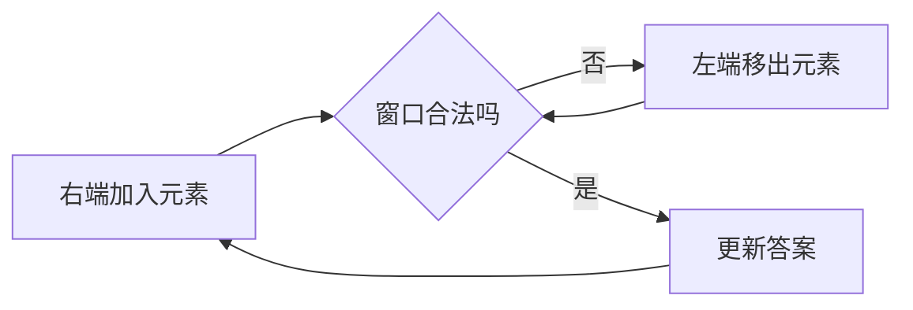
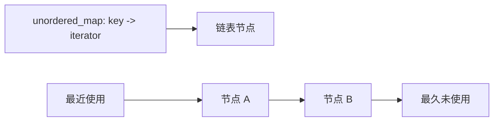
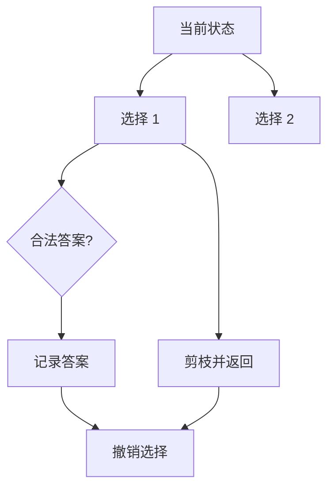

# 算法专题复习笔记

> 创建日期：2026-11-01
> 更新日期：2026-11-01
> 修改日期：2026-11-01
> AI辅助模型：GPT-6（未确认具体型号）

按解题模型整理的九个专题。每章保留核心思路、关键模板、源码链接和易错点，适合按顺序学习或通过目录查阅。

本文于上述创建日期合并整理；原始专题笔记的创建日期未知（历史文档未记录）。前八章的代码片段用于说明思路，完整实现以链接的源码为准；其中“已验证”等状态沿用原笔记。本次新增第九章排序实现，代码直接收录在文档中，并单独完成编译与运行验证。

## 目录

1. [数组、字符串与哈希](#1-数组字符串与哈希)
2. [双指针与滑动窗口](#2-双指针与滑动窗口)
3. [栈、队列与堆](#3-栈队列与堆)
4. [链表](#4-链表)
5. [树、Trie 与搜索](#5-树trie-与搜索)
6. [二分查找](#6-二分查找)
7. [动态规划与贪心](#7-动态规划与贪心)
8. [位运算、数学与杂项](#8-位运算数学与杂项)
9. [经典排序算法：快速排序与堆排序](#9-经典排序算法快速排序与堆排序)

---

## 1. 数组、字符串与哈希

### 1.1 核心思想

数组的优势是按下标访问；哈希表的优势是用额外空间换近似 `O(1)` 查询。题目出现“是否出现过、出现次数、两数关系、连续子数组和”时，优先考虑哈希；出现“原地修改”时，先明确有效区间。

生活化理解：数组像一排有编号的储物柜，哈希表像姓名到柜号的登记表。

### 1.2 三个高频模型

#### 1. 计数哈希

```cpp
unordered_map<int, int> count;
for (int x : nums) ++count[x];
```

若字符集固定且很小，优先用数组计数，常数更小。仓库中的有效字母异位词使用 26 个计数槽：[242_valid_anagram.cc](../../algo/string_and_array/242_valid_anagram.cc#L17-L34)。

#### 2. 前缀和 + 哈希

若 `prefix[i] - prefix[j] == k`，就把问题改写为“此前出现过多少个 `prefix[i] - k`”。

```cpp
unordered_map<int, int> frequency{{0, 1}};
int prefix = 0, answer = 0;
for (int x : nums) {
  prefix += x;
  answer += frequency[prefix - k];
  ++frequency[prefix];
}
```

关键是先放入 `{0, 1}`，它代表从下标 0 开始的子数组。仓库中已有朴素与哈希两种写法，但目前同名重定义，仍属待迁移代码：[lcr_solution.cc](../../algo/LCR/lcr_solution.cc#L69-L119)。

#### 3. 区间合并

先按左端点排序；扫描时只需比较“当前区间左端点”和“结果最后一个区间右端点”。

```text
已合并: [1--------6]
当前:        [4---------9]
结果:   [1-------------9]
```

代表实现：[56_merge_intervals.cpp](../../algo/string_and_array/56_merge_intervals.cpp#L22-L44)。

### 1.3 复杂度与易错点

| 模型 | 时间 | 空间 | 常见错误 |
|---|---:|---:|---|
| 数组计数 | `O(n + K)` | `O(K)` | 忘记字符范围 |
| 哈希计数 | 平均 `O(n)` | `O(n)` | 使用 `operator[]` 意外插入键 |
| 前缀和 | `O(n)` | `O(n)` | 更新次数早于查询，导致重复计数 |
| 区间合并 | `O(n log n)` | `O(n)` | 没有先排序、端点相等处理错误 |

### 1.4 复习清单

- 能解释为什么前缀和把“连续区间”变成两个前缀的差。
- 能在数组计数与 `unordered_map` 之间做选择。
- 能手写区间合并，并覆盖空输入、单区间、完全包含和首尾相接。

[返回目录](#目录)

---

## 2. 双指针与滑动窗口

### 2.1 核心思想

双指针不是“放两个变量”，而是利用单调性避免重复扫描。必须先说清：每个指针代表什么，以及移动后仍保持什么不变量。

### 2.2 同向双指针：读写分离

`read` 负责探索，`write` 维护答案区间。删除元素时，不变量是 `[0, write)` 始终只包含应保留的元素。

```cpp
int write = 0;
for (int value : nums) {
  if (should_keep(value)) nums[write++] = value;
}
```

已验证示例：[27_remove_element.cpp](../../algo/string_and_array/27_remove_element.cpp#L13-L39)。

### 2.3 相向双指针：有序数组夹逼

三数之和先排序、固定第一个数，再让左右指针逼近目标：[3sum.cpp](../../algo/string_and_array/3sum.cpp#L25-L66)。

```text
[-4, -1, -1, 0, 1, 2]
      fixed  L        R

sum 太小 -> L 右移
sum 太大 -> R 左移
sum 命中 -> 记录并跳过重复值
```

不变量：被左右边界排除的组合不可能再构成答案。排序的价值不仅是夹逼，也让去重变成“跳过相邻相同值”。

### 2.4 滑动窗口

适用信号：连续子数组/子串、最长或最短、窗口条件可随右端点扩张并通过左端点收缩恢复。

```cpp
for (int right = 0; right < n; ++right) {
  add(nums[right]);
  while (!valid()) remove(nums[left++]);
  update_answer(left, right);
}
```



### 2.5 快慢指针

链表判环中，慢指针一次一步、快指针一次两步；若有环，快指针会像操场跑圈的人一样从后方追上慢指针。数组原地去重也可视为快慢指针。

### 2.6 易错点与训练

- 窗口是 `[left, right]` 还是 `[left, right)` 必须统一。
- “最长合法窗口”通常非法时收缩；“最短满足窗口”通常合法时继续收缩。
- 去重应在排序后完成，并分别处理固定指针、左指针和右指针。
- 练习顺序：移除元素 → 两数之和 II → 三数之和 → 最长无重复子串 → 最小覆盖子串。

[返回目录](#目录)

---

## 3. 栈、队列与堆

### 3.1 栈：处理最近尚未完成的事情

栈是“后进先出”。括号匹配时，栈顶就是最近一个尚未闭合的左括号；表达式求值时，栈保存暂时不能结算的状态。括号实现入口：[20_valid_parentheses.cpp](../../algo/stack/20_valid_parentheses.cpp#L22-L45)。

```cpp
stack<char> pending;
for (char ch : text) {
  if (is_left(ch)) pending.push(ch);
  else {
    if (pending.empty() || !matches(pending.top(), ch)) return false;
    pending.pop();
  }
}
return pending.empty();
```

### 3.2 单调队列：窗口最大值

队列中存下标，并让对应值从队头到队尾单调递减。新元素入队前，删除队尾所有不可能再成为最大值的元素；队头过期时弹出。

```text
窗口值:  [1, 3, -1, -3, 5]
候选队列: 3, -1, -3
新来 5:  -3、-1、3 都永久失去竞争资格 -> 只留 5
```

代表实现：[slide_window_max.cpp](../../algo/queue/slide_window_max.cpp#L29-L69)。每个下标最多入队、出队各一次，因此时间为 `O(n)`。

### 3.3 堆：只关心动态极值

Top K 不需要全排序。维护大小为 `k` 的小顶堆：堆顶是当前 K 个最大值中最小的那个，也是最应该被替换的候选。

```cpp
priority_queue<int, vector<int>, greater<int>> top_k;
for (int x : nums) {
  top_k.push(x);
  if (top_k.size() > k) top_k.pop();
}
```

仓库示例：[find_kth_largest.cpp](../../algo/top_k/find_kth_largest.cpp#L22-L37)。复杂度为 `O(n log k)`，空间为 `O(k)`。

### 3.4 选择口诀

| 需求 | 结构 |
|---|---|
| 最近一个未完成状态 | 栈 |
| 按进入顺序处理 | 队列 |
| 窗口极值且元素会过期 | 单调双端队列 |
| 动态最大/最小、Top K | 堆 |

易错点：堆比较器方向与直觉相反；单调队列必须存下标才能判断过期；栈题最后仍需检查是否为空。

[返回目录](#目录)

---

## 4. 链表

### 4.1 核心思想

链表题的难点不是遍历，而是修改指针时不丢失“下一站”。动手前先写出每个指针的职责；修改 `current->next` 前，通常先保存 `next`。

### 4.2 虚拟头节点

当头节点可能被删除或替换时，引入 `dummy`，让所有节点都拥有统一的前驱。

```text
dummy -> 1 -> 2 -> 3
  pre    cur
```

```cpp
ListNode dummy(0, head);
ListNode* previous = &dummy;
```

仓库的“删除全部重复节点”实现展示了虚拟头节点思路：[83_remove_duplicates.cpp](../../algo/linked_list/83_remove_duplicates.cpp#L126-L145)。该历史文件包含多种实现，尚未纳入默认 CMake 构建。

### 4.3 反转链表模板

```cpp
ListNode* previous = nullptr;
while (head != nullptr) {
  ListNode* next = head->next;
  head->next = previous;
  previous = head;
  head = next;
}
return previous;
```

不变量：`previous` 指向已经反转完成的链表头，`head` 指向尚未处理的第一个节点。

### 4.4 快慢指针与双指针

- 判环：快指针每次两步，慢指针每次一步。
- 倒数第 K 个：快指针先走 K 步，再与慢指针同步移动。
- 相交链表：两个指针分别走 `A+B` 与 `B+A`，消除长度差。

### 4.5 LRU：哈希表 + 双向链表

哈希表负责 `O(1)` 找节点，双向链表负责 `O(1)` 移动和淘汰。仓库实现使用 `list` 保存访问顺序，用 map 保存迭代器：[146_lru_cache.cpp](../../algo/linked_list/146_lru_cache.cpp#L18-L63)。



### 4.6 易错点

- 删除节点后继续访问已释放指针。
- 反转区间时忘记连接区间前后两端。
- 合并链表时未保存当前节点的 `next`。
- 使用裸 `new` 后没有明确所有权；面试代码可简化，但本地测试应释放辅助节点。

[返回目录](#目录)

---

## 5. 树、Trie 与搜索

### 5.1 树递归：先定义函数语义

树题先回答：“这个函数对一棵以 `root` 为根的树返回什么？”递归不是从代码细节开始，而是相信左右子树能返回约定结果，再组合它们。

```cpp
Result solve(TreeNode* root) {
  if (root == nullptr) return base;
  Result left = solve(root->left);
  Result right = solve(root->right);
  return combine(root, left, right);
}
```

例如验证 BST 时，递归参数携带当前节点允许的开区间 `(lower, upper)`：[binary_tree.cpp](../../algo/tree/binary_tree.cpp#L46-L62)。该历史文件包含重复 `Solution`，尚未纳入默认构建。

### 5.2 DFS、BFS 与回溯

- DFS：沿一条路走到底，适合路径、连通性、组合枚举。
- BFS：按层扩散，适合无权最短步数、层序遍历。
- 回溯：DFS + 选择列表 + 撤销选择，适合排列组合和分割。

```cpp
void backtrack(State& state) {
  if (is_answer(state)) {
    answers.push_back(state);
    return;
  }
  for (Choice choice : choices(state)) {
    apply(state, choice);
    backtrack(state);
    undo(state, choice);
  }
}
```



恢复 IP 地址展示了“层数、起点、合法性剪枝”三件事：[bm74_restore_ip_addresses.cpp](../../algo/DP/bm74_restore_ip_addresses.cpp#L13-L56)。

### 5.3 Trie：用路径表示前缀

Trie 节点不保存完整单词；从根到节点的路径就是前缀，`is_word` 区分“只是前缀”和“完整单词”。仓库实现：[208_trie.cpp](../../algo/tree/208_trie.cpp#L29-L92)。

```text
root
 └─ c
    └─ a
       ├─ t*    cat
       └─ r*    car
```

插入、查询、前缀查询均为 `O(L)`，其中 `L` 是字符串长度；代价是节点分支带来的空间开销。

### 5.4 易错点与复习

- 递归终止条件与空节点语义不一致。
- 回溯忘记撤销，导致不同分支共享污染状态。
- 二维网格 DFS 忘记恢复访问标记或越界判断。
- Trie 查询前缀时错误要求 `is_word == true`。
- 练习顺序：遍历 → 最大深度 → 路径和 → 层序 → 构造树 → 排列组合 → 单词搜索。

[返回目录](#目录)

---

## 6. 二分查找

### 6.1 核心思想

二分查找的本质不是“数组有序”，而是存在一个能把搜索空间分成两半的单调判定。写代码前先决定区间定义，本章统一使用闭区间 `[left, right]`。

### 6.2 闭区间模板

```cpp
int left = 0;
int right = static_cast<int>(nums.size()) - 1;
while (left <= right) {
  int middle = left + (right - left) / 2;
  if (nums[middle] == target) return middle;
  if (nums[middle] < target) left = middle + 1;
  else right = middle - 1;
}
return -1;
```

已验证实现：[704_binary_search.cpp](../../algo/binary_search/704_binary_search.cpp#L15-L41)。

### 6.3 为什么是 `left <= right`

闭区间在 `left == right` 时仍有一个候选元素，必须继续判断。每次更新使用 `middle + 1` 或 `middle - 1`，因为 `middle` 已经检查过。

```text
下标:  0  1  2  3  4  5
数值: -1  0  3  5  9 12
       L       M        R
```

### 6.4 边界二分

找“第一个满足条件的位置”时，不要在命中后立即返回，而是记录答案并继续向左收缩：

```cpp
int answer = n;
while (left <= right) {
  int middle = left + (right - left) / 2;
  if (check(middle)) {
    answer = middle;
    right = middle - 1;
  } else {
    left = middle + 1;
  }
}
```

旋转数组的关键是每轮至少有一半有序，再判断目标是否落在这一半。矩阵、平方根和“第 K 小”也可转化为单调判定；平方根示例：[math_solution.cc](../../algo/math/math_solution.cc#L20-L40)。

### 6.5 易错点

- 空数组时 `size() - 1` 的无符号下溢：先转为有符号整数。
- `middle = (left + right) / 2` 可能溢出。
- 混用闭区间与半开区间更新规则。
- 答案二分时不会证明 `check(x)` 的单调性。

默写检查：区间含义、循环条件、更新是否排除 `middle`、未找到时返回什么。

[返回目录](#目录)

---

## 7. 动态规划与贪心

### 7.1 动态规划：记录重复子问题

DP 的核心不是填表，而是定义状态。四步法：

1. `dp[i]` 或 `dp[i][j]` 表示什么。
2. 最后一步从哪些更小状态转移而来。
3. 初始化哪些最小问题。
4. 按依赖顺序遍历并决定最终答案位置。


通用一维模板：

```cpp
vector<int> dp(n, initial);
for (int i = 1; i < n; ++i) {
  dp[i] = best(dp[i - 1], transition(i));
}
```

股票只能交易一次时，“截至今天的最低买入价”就是压缩后的历史状态；已验证实现：[121_best_time_to_buy_and_sell_stock.cpp](../../algo/DP/121_best_time_to_buy_and_sell_stock.cpp#L14-L34)。

### 7.2 背包遍历顺序

- 0/1 背包：容量倒序，避免同一件物品在一轮中重复使用。
- 完全背包：容量正序，允许重复使用当前物品。
- 求组合数与求排列数的循环顺序不同，必须从状态语义推导，不能死背。

### 7.3 贪心：证明局部选择不损失最优解

贪心适用时，每一步只保留对未来最有利的状态。判断标准不是“看起来最优”，而是能用交换论证或覆盖范围证明：替换为当前选择不会让全局答案变差。

股票可多次交易时，所有正的相邻差值都可以收入囊中：[122_best_time_to_buy_and_sell_stock_ii.cpp](../../algo/DP/122_best_time_to_buy_and_sell_stock_ii.cpp#L13-L30)。这等价于把一段连续上涨拆成若干天收益：

```text
1 -> 3 -> 5
整体收益 5-1 = 4
逐日收益 (3-1) + (5-3) = 4
```

### 7.4 DP 与贪心的区别

| 问题 | DP | 贪心 |
|---|---|---|
| 保留状态 | 多个可能有用的历史状态 | 一个被证明足够的最优状态 |
| 正确性来源 | 状态覆盖所有选择 | 局部选择可安全替换 |
| 常见代价 | 时间/空间较高 | 通常更低，但证明更难 |

### 7.5 易错点

- 状态定义含糊，导致转移式“凭感觉”。
- 初始化与状态语义不一致。
- 原地压缩后遍历方向错误。
- 把“局部看起来最大”误当作贪心证明。

[返回目录](#目录)

---

## 8. 位运算、数学与杂项

### 8.1 位运算

高频性质：

```text
x ^ x = 0
x ^ 0 = x
x & (x - 1) 会清除最低位的 1
x & -x 会保留最低位的 1
```

当题目出现“其他数字出现偶数次，只有一个出现奇数次”，异或能像成对消除一样留下答案。

逐位处理模板：

```cpp
for (int bit = 0; bit < 32; ++bit) {
  int current = value & 1;
  value >>= 1;
  // 使用 current
}
```

仓库的 32 位反转实现使用了逐位扫描：[bits_reverse.cpp](../../algo/bit_manipulation/bits_reverse.cpp#L19-L29)。注意使用无符号整数，避免有符号右移和最高位溢出的歧义。

### 8.2 数学题的三个切入点

1. 找单调性：平方根可二分答案。
2. 找周期：取模、循环节、数字位变化。
3. 控制溢出：用除法比较代替乘法，或提升到 `long long`。

平方根中判断 `mid * mid <= x` 可能溢出，更稳妥的写法是 `mid <= x / mid`。仓库现有平方根实现可作为待改进案例：[math_solution.cc](../../algo/math/math_solution.cc#L20-L40)。

### 8.3 随机洗牌

不要使用 C++17 已移除的 `random_shuffle`。规范实现使用 `std::shuffle` 和显式随机引擎，并通过排序检查结果仍是原数组的一个排列：[shuffle.cpp](../../algo/others/shuffle.cpp#L12-L39)。

### 8.4 杂项题处理原则

“杂项”不应成为永久分类。每做完一题都尝试给它贴上技术标签，例如：模拟、排序、状态机、前缀和或随机化；同一标签积累到 3～5 题时，再独立成章。

### 8.5 复习清单

- 能不查资料写出四个常用位运算性质。
- 位移前明确有符号/无符号以及位宽。
- 乘法比较前检查溢出。
- 随机算法测试性质而非某个固定排列。

[返回目录](#目录)


---

## 9. 经典排序算法：快速排序与堆排序

### 9.1 目标与接口约定

给定整数数组，将元素按从小到大的顺序原地排列。例如 `[4, 2, 4, 1, 4, 3]` 排序后为 `[1, 2, 3, 4, 4, 4]`。

- `QuickSort(nums)`：快速排序，按基准值划分数组，再处理两侧。
- `HeapSort(nums)`：堆排序，反复取出当前最大值并放到数组末尾。
- 两个接口都接收 `std::vector<int>&`，直接修改数组，支持空数组、单元素、负数和重复值，无返回值。
- 实现使用标准 C++11，不使用异常处理。排序过程不创建新的数组；快速排序需要递归栈，堆排序只使用固定数量的变量。容器分配等资源失败不在本教学实现的恢复范围内。

以下三个代码块依次复制到同一个 `.cpp` 文件即可组成两种排序的完整实现。运行示例见 9.5 节。

```cpp
#include <algorithm>
#include <cstddef>
#include <vector>
```

### 9.2 快速排序：先划分，再递归

快速排序的核心分成两层：`Partition` 负责把一个基准元素放到最终位置；`QuickSortRange` 负责递归排序它左右两侧的区间。

[《算法》第四版配套源码 Quick.java](https://github.com/kevin-wayne/algs4/blob/master/src/main/java/edu/princeton/cs/algs4/Quick.java) 也采用这个结构：检查终止条件，调用划分函数，再递归两侧。原版使用双向扫描交换，并在排序前随机打乱输入。下面保留这一递归结构，划分过程采用便于手动跟踪的“挖坑填数”写法，不加入随机打乱、三路划分或递归深度优化。

**划分过程。** 先保存区间第一个元素作为基准，将它原来的位置视为一个待填位置：

1. 从右向左找小于基准的元素，填入左侧待填位置；右侧留下新的待填位置。
2. 从左向右找大于基准的元素，填入右侧待填位置。
3. 两个指针相遇时，将基准填回相遇位置，并返回这个下标。

例如对 `[4, 2, 5, 1, 3]`，选择 `4` 作为基准。`_` 仅表示逻辑上的待填位置，并不是真正删除数组元素：

```text
保存 4：    [_, 2, 5, 1, 3]
右侧 3 填左：[3, 2, 5, 1, _]
左侧 5 填右：[3, 2, _, 1, 5]
右侧 1 填左：[3, 2, 1, _, 5]
指针相遇：  [3, 2, 1 | 4 | 5]
递归处理：  [3, 2, 1] 和 [5]
```

**区间约定。** 使用半开区间 `[left, right)`，不包含 `right`。划分返回基准下标 `middle`，之后递归 `[left, middle)` 和 `[middle + 1, right)`，两边都排除已就位的基准。

```cpp
// 划分非空区间 [left, right)，返回基准最终所在的下标。
std::size_t Partition(std::vector<int>& nums, std::size_t left,
                      std::size_t right) {
  const int pivot = nums[left];
  std::size_t low = left;
  std::size_t high = right - 1;
  while (low < high) {
    // 先从右侧找小于基准的元素，填到左侧待填位置。
    while (low < high && nums[high] >= pivot) {
      --high;
    }
    nums[low] = nums[high];
    // 再从左侧找大于基准的元素，填到右侧待填位置。
    while (low < high && nums[low] <= pivot) {
      ++low;
    }
    nums[high] = nums[low];
  }
  nums[low] = pivot;
  return low;
}

// 排序合法的半开区间 [left, right)。
void QuickSortRange(std::vector<int>& nums, std::size_t left,
                    std::size_t right) {
  if (right - left <= 1) {
    return;
  }
  const std::size_t middle = Partition(nums, left, right);
  QuickSortRange(nums, left, middle);
  QuickSortRange(nums, middle + 1, right);
}

void QuickSort(std::vector<int>& nums) {
  QuickSortRange(nums, 0, nums.size());
}
```

**为什么正确。** 划分过程中，左侧已经处理的元素不大于基准，右侧已经处理的元素不小于基准，待处理区间不断缩小。相遇后放回基准，它的位置就确定了。递归将左右两段分别排好，整个区间便有序；每次递归都排除基准，所以区间必然缩小。

**易错点与限制。**

- 必须先保存基准值，否则第一次填数就会覆盖它。
- 两次扫描都必须检查 `low < high`，防止指针越过彼此。
- 扫描条件包含等号，使相等元素也能被跳过，避免指针停滞。
- 这个基础版本固定选择首元素，遇到有序、逆序或全相等数组时会退化，时间为 `O(n²)`、递归栈为 `O(n)`；超大退化输入可能耗尽调用栈。它适合学习划分与递归，优化可在掌握基础后再讨论。

### 9.3 堆排序：大顶堆

**核心思路。** 大顶堆是一棵用数组保存的完全二叉树，每个父节点的值都不小于子节点，因此根节点一定是最大值。对下标 `i`，左孩子是 `2*i+1`，右孩子是 `2*i+2`；孩子下标必须小于当前堆大小。

升序排序分成两步：

1. 从最后一个非叶节点向前执行向下调整，建立大顶堆。处理某个父节点时，它的左右子树已经是堆。
2. 将堆顶与堆的最后一个元素交换，把最大值放入右侧已排序区间；缩小堆后，再对根节点向下调整。

```text
输入：      [3, 1, 4, 2]
建大顶堆：  [4, 2, 3, 1]
交换堆顶：  [1, 2, 3 | 4]    4 已经就位
向下调整：  [3, 2, 1 | 4]    左侧重新成为大顶堆
继续取最大：[2, 1 | 3, 4] -> [1 | 2, 3, 4]
```

**为什么向下调整正确。** 左右子树已经是堆时，只可能是当前父节点太小。将父节点与较大的孩子交换后，当前位置满足堆条件；继续检查被换下去的位置即可。不能随意选择一个孩子，例如父节点为 `1`、两个孩子分别为 `5` 和 `8`，只与 `5` 交换仍会违反大顶堆条件。

```cpp
// [0, heap_size) 为堆区间，root 的左右子树已经是大顶堆。
// 将 root 向下调整，使以它为根的子树也满足父节点不小于子节点。
void SiftDown(std::vector<int>& nums, std::size_t root,
              std::size_t heap_size) {
  // 只有前 heap_size / 2 个节点有孩子；先判断再计算孩子下标。
  while (root < heap_size / 2) {
    std::size_t child = root * 2 + 1;
    if (child + 1 < heap_size && nums[child + 1] > nums[child]) {
      ++child;
    }
    if (nums[root] >= nums[child]) {
      return;
    }
    // 必须选择较大的孩子，否则交换后父节点可能小于另一孩子。
    std::swap(nums[root], nums[child]);
    root = child;
  }
}

// 原地升序排序；额外空间为 O(1)。
void HeapSort(std::vector<int>& nums) {
  const std::size_t size = nums.size();
  // 从最后一个非叶节点向前建堆，避免无符号下标减到负数。
  for (std::size_t parent = size / 2; parent > 0; --parent) {
    SiftDown(nums, parent - 1, size);
  }
  // [heap_size, size) 已升序排好；每次把堆顶最大值放到它前面。
  for (std::size_t heap_size = size; heap_size > 1; --heap_size) {
    std::swap(nums[0], nums[heap_size - 1]);
    SiftDown(nums, 0, heap_size - 1);
  }
}
```

**易错点。**

- 升序排序使用大顶堆：最大值不断移到右端；使用小顶堆并执行同样的交换过程会得到降序结果。
- 向下调整只检查当前堆区间，不能将右侧已经排序的元素重新算进来。
- 无符号下标不能用 `i >= 0` 控制倒序循环，否则减到零后会回绕。本实现通过 `parent > 0` 和 `parent - 1` 避免该问题。
- 先比较父节点与较大孩子，父节点已经足够大时立即停止，不需要一直走到叶节点。

### 9.4 复杂度与选择

| 算法 | 平均时间 | 最坏时间 | 本文实现的额外空间 | 稳定性 |
|---|---|---|---|---|
| 快速排序（基础递归版） | 不同元素随机排列下 `O(n log n)` | `O(n²)` | 平均 `O(log n)`、最坏 `O(n)` 递归栈 | 不稳定 |
| 堆排序 | `O(n log n)` | `O(n log n)` | `O(1)` | 不稳定 |

稳定排序指：相同关键字的记录在排序后保持原有先后顺序。这里虽然只排序整数，但两种算法跨位置移动元素的过程都不能保证附带记录的相对顺序。

快速排序每轮划分为线性扫描，划分较均匀时有约 `log n` 层；连续出现极端不均匀划分时，各轮工作量可能接近 `n + (n-1) + … + 1`。本文固定选择首元素，不对任意输入保证平均表现。有序、逆序或全相等输入都会产生不均匀划分，时间退化为 `O(n²)`，递归深度退化为 `O(n)`。

堆排序的自底向上建堆是 `O(n)`，不是 `O(n log n)`：约一半节点是叶节点，无需调整；约四分之一节点最多下降一层，约八分之一最多下降两层，总工作量形成收敛加权级数。随后至多 `n-1` 次取出最大值，每次调整最多 `O(log n)`，总时间为 `O(n log n)`。

复习时重点掌握快速排序的区间划分，以及堆排序的建堆与向下调整。如果要求最坏时间上界和常数额外空间，堆排序更符合这两个条件；如果需要稳定性，这两份实现都不适用。

### 9.5 调用示例与验证

将下面的 `main` 接在上述实现之后，可分别检查两种排序的结果：

```cpp
int main() {
  const std::vector<int> input = {4, 2, 4, 1, 4, 3};
  const std::vector<int> expected = {1, 2, 3, 4, 4, 4};
  std::vector<int> quick = input;
  std::vector<int> heap = input;
  QuickSort(quick);
  HeapSort(heap);
  return quick == expected && heap == expected ? 0 : 1;
}
```

例如保存为 `sorting_demo.cpp`，在文件所在目录运行：

```sh
c++ -std=c++11 -pedantic-errors -Wall -Wextra -Werror -fno-exceptions sorting_demo.cpp -o sorting_demo
./sorting_demo
```

本次将文档中的实现单独编译，在 Debug（`-O0 -g`）与 Release（`-O2 -DNDEBUG`）配置下运行，均与 `std::sort` 对照通过：

- 空数组、单元素、两个元素、重复值、负数及 `INT_MIN` / `INT_MAX`。
- 穷举长度为 0～8、元素取值为 `-1`、`0`、`1` 的所有数组。
- 固定随机种子 `20261101` 的 1000 组随机数组。
- 各 2000 个元素的有序、逆序、全相等数组，覆盖基础快排的退化情况；不将大规模退化输入作为递归栈安全的保证。

复习检查：能独立写出 `Partition`，说明划分后为什么递归左右两侧且排除基准，以及堆排序为何选择较大孩子、为何建堆是线性时间。

[返回目录](#目录)
